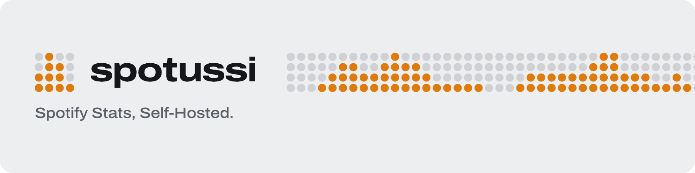
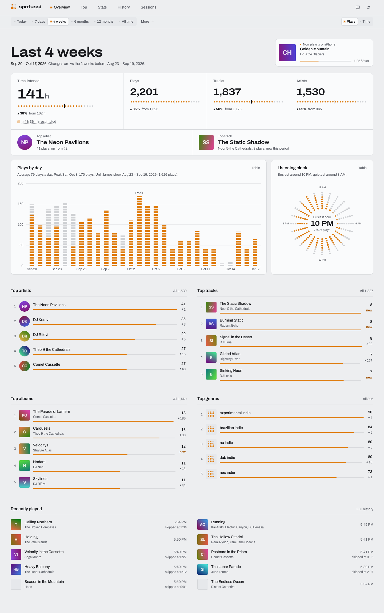

<picture>
  <source media="(prefers-color-scheme: dark)" srcset="brand/social/readme-header-dark.png">
  
</picture>

A fast, self-hosted listening-stats dashboard for one Spotify account: live capture of what you play, your whole history from Spotify's export, and dashboards that answer in milliseconds at any history size. One Go binary with the web UI built in, one SQLite file, one container, no required settings. A read-only API and an MCP server let scripts and AI assistants ask the same questions.

<picture>
  <source media="(prefers-color-scheme: dark)" srcset="docs/project/screenshots/u1/overview-desktop-dark.png">
  
</picture>

> **0.1 beta.** The data model and the API can still change between 0.x releases; read the [release notes](https://github.com/jasoncronje/spotussi/releases) and back up before upgrading.

## Quick start

You need Docker and a Spotify account with Premium (Spotify only lets Premium accounts create the developer app spotussi connects through). Save this as `compose.yaml`:

```yaml
services:
  spotussi:
    image: ghcr.io/jasoncronje/spotussi:0.1.0-beta.2
    restart: unless-stopped
    ports:
      - "8080:8080"
    volumes:
      - spotussi-data:/data
volumes:
  spotussi-data:
```

```sh
docker compose up -d
docker compose logs spotussi | grep -A3 "setup token"
```

Open `http://<server>:8080`, enter the setup token, and follow the wizard to connect Spotify. Then request your Extended Streaming History from Spotify (it takes days to weeks) and [import it](docs/import.md) when it arrives.

## Documentation

- [Install and update](docs/install.md): HTTPS behind Traefik, single sign-on, standalone binaries
- [Connecting Spotify](docs/spotify.md): the developer app, live capture, artwork and metadata
- [Importing your history](docs/import.md)
- [Backup and restore](docs/backup.md)
- [Configuration](docs/configuration.md): environment variables and the command line
- [API and MCP](docs/mcp.md)
- [Contributing](CONTRIBUTING.md) and [security](SECURITY.md)

## License

Copyright (C) 2026 Jason Cronje. spotussi is free software under the [GNU Affero General Public License v3.0 only](LICENSE) (`AGPL-3.0-only`), without any warranty. Running it for yourself owes nothing; if you run a modified version as a service for others, you must offer them its source (section 13). Third-party assets keep their own licenses, listed in [`site/assets/credits.json`](site/assets/credits.json).
