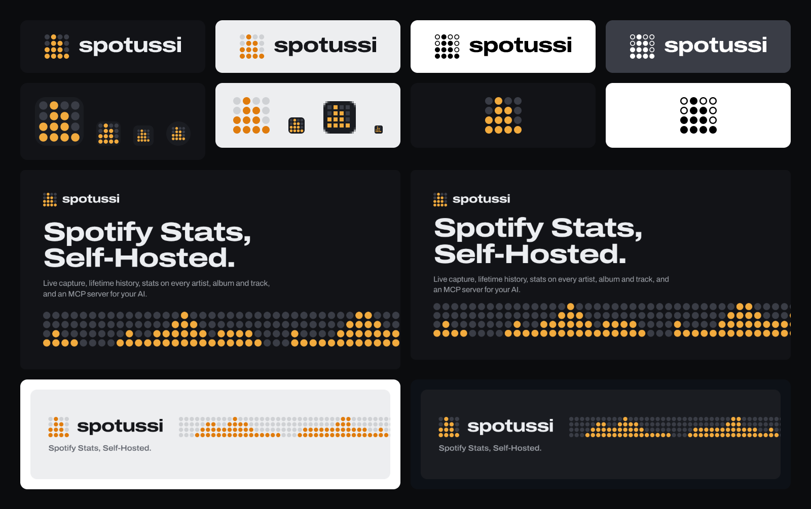

# spotussi brand kit

The mark is the app's own level meter: a 4×4 grille of lamps, lit from the bottom to heights 2·4·3·1, in the app's amber on graphite. It is drawn from straight columns of dots, with no circles, waves or green, so it can't be mistaken for a streaming service's logo.



## Files

| Use | File |
| --- | --- |
| App icon, avatars, anywhere the ground is unknown | `logo/mark.svg` (lamps on a graphite plate) |
| Mark on a dark ground | `logo/mark-dark.svg` |
| Mark on a light ground | `logo/mark-light.svg` |
| Name with the mark | `logo/lockup-dark.svg`, `logo/lockup-light.svg` |
| One colour (print, engraving, embossing) | `logo/*-mono-black.svg`, `logo/*-mono-white.svg` |
| Name alone, when the mark is already nearby | `logo/wordmark-*.svg` |
| Browser and home-screen icons | `web/` (copied into `web/static`) |
| Link previews | `social/og-1200x630.png` (Open Graph), `social/github-social-1280x640.png` (GitHub social preview) |
| README header | `social/readme-header-light.png`, `social/readme-header-dark.png` |

Every file comes from `scripts/build.mjs`. The wordmark is outlined from Archivo, so no SVG needs the font.

## Clear space and size

- **Clear space:** keep one lamp pitch, the distance between two lamp centres, clear on every side of the mark and the lockup. That is about a quarter of the mark's height.
- **Smallest sizes:** the lockup at 20 px tall, the bare mark at 12 px, the plated mark at 16 px (the `favicon.ico` 16 px frame is redrawn on whole pixels for that size).
- **Lockup geometry:** the mark is 2.2 x-heights of the wordmark tall, centred on the x-height, and 0.42 of its own height from the word.

## Colours

| Name | Hex | Role | App token |
| --- | --- | --- | --- |
| Console | `#121317` | Dark ground, `theme-color` | `--background` (dark) |
| Graphite | `#1A1C21` | The plate, dark panels | `--card` (dark) |
| Grille | `#3A3D46` | Unlit lamps on dark grounds | `--grille` (dark) |
| Lamp | `#F2AB3E` | Lit lamps on dark grounds | `--signal` (dark) |
| Aluminium | `#EDEEF0` | Light ground | `--background` (light) |
| Grille, day | `#CFD1D4` | Unlit lamps on light grounds | `--grille` (light) |
| Ember | `#DF7B0C` | Lit lamps on light grounds | `--signal` (light) |
| Ink | `#16171B` | Type on light grounds | `--foreground` (light) |
| Paper | `#ECEEF1` | Type on dark grounds | `--foreground` (dark) |

Amber is the only colour. It marks something lit: a lamp, a value. Everything else is graphite, aluminium and their greys.

## Type

Archivo, one family, using its width axis. The wordmark is Archivo at 125% width, weight 760, tracking −0.035 em, always lowercase. Headlines use the same cut; running text uses the normal width.

## Do

- Use `mark.svg` when you don't control the ground. The plate keeps it legible on white, black and photos.
- Use the `-light` files on light grounds and the `-dark` files on dark grounds. The amber shifts from lamp to ember so the lit lamps keep their contrast.
- Carry the grille on as a meter strip (see the social images) when a layout needs a graphic. Keep the mark's lamp pitch and rows, and use made-up heights, never real listening data.

## Don't

- Change the lit pattern, the number of lamps, or the lamps' shape.
- Recolour the lamps, add a second accent, or put the mark on green.
- Set "spotussi" in another typeface, in capitals, or with the first letter capitalised.
- Stretch, rotate, outline, shadow or add a glow to the mark.
- Pair the mark with a third party's logo, or imply an affiliation with Spotify.

## Rebuilding

```sh
node brand/scripts/build.mjs
```

It needs Google Chrome (set `CHROME` if it isn't in `/Applications`) and `web/node_modules` for the Archivo font, and copies the web icons into `web/static`. *spotussi* is a working name; to change the wordmark, re-outline it and rebuild:

```sh
uv run --with fonttools --with brotli --with uharfbuzz python brand/scripts/outline.py \
  web/node_modules/@fontsource-variable/archivo/files/archivo-latin-wdth-normal.woff2 \
  760 125 -35 newname > brand/src/wordmark.json
```

`previews/mark-directions.png` records the three directions the mark was chosen from (Ladder, chosen; Peak hold; Matrix s).
