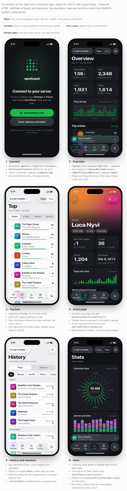

# iPhone app: MVP scope

A proposal, not yet decided. Once the owner settles the open decisions at the end, they move into [decisions.md](decisions.md) and the milestones into [plan.md](plan.md).

The mockups are HTML sketches of layout and hierarchy ([ios/mockups.html](ios/mockups.html), built by `python3 docs/project/ios/build_mockups.py <out.html>`). They use the mock server's sample music, not real listening. The real glass, type and controls come from SwiftUI's system components.

## What the MVP is

A read-only companion to one spotussi instance. The phone holds no listening data of its own: it pairs with your server using an API token (D13) and shows the D14 views through the same `/api/v1` the web app uses (D6, D16). Capture, import, hydration and every setting stay on the server.

API tokens are read-only and work in every auth mode, including behind forward auth (with the token router from [install.md](../install.md)). So the app needs no login screen, no cookies and no CSRF handling, and a lost phone can be cut off by revoking one token.

## Scope

| In the MVP | Left for later |
|---|---|
| Pairing: scan a QR code from Settings → Tokens, or type the address and token | Sign-in with the owner password; several instances |
| Overview: summary cards with change, plays by day, top 5 lists, recent plays | Home Screen and Lock Screen widgets |
| Now playing, in the tab bar's accessory | A Live Activity (needs push from the server) |
| Top tracks, artists, albums, genres, with rank movement and endless paging | Library and playlists (D36) |
| Stats: the six D14 charts and the listening clock | Year in Review, period comparison (DF8) |
| Artist, album, track and genre pages | Share cards |
| History with filters, and Longest sessions | Editing settings, exclusions, playlist names |
| Search (catalog search, `/search`) | Import and Spotify connect (web only) |
| Range picker (all D14 presets and custom) and the Plays/Time switch | iPad and Mac layouts beyond what resizing gives for free |
| Instance status: reconnect-Spotify and catalog-progress notices, read-only | Notifications |
| Demo mode on bundled sample data (also what App Review would use) | "Ask your stats" with on-device models |
| Last-seen data when the server can't be reached | A full offline database |

## What the server and web app need

One addition: **Pair iPhone** in Settings → Tokens. It creates a token named for the phone and shows a QR code holding `spotussi://pair?url=<base URL>&token=<spt_…>`, once, like any new token. Everything else the app needs is already in the contract.

To check during the first milestone: whether entity responses carry enough to build an "Open in Spotify" link (the spec says clients must not parse IDs), and how plain-HTTP LAN and Tailscale addresses behave under App Transport Security.

## Design

The app keeps the level-meter direction (D19, D34, D40): graphite and aluminium, one green that marks something lit, and the lamp grid for the mark, the day chart and the listening clock. Liquid Glass changes where the chrome lives, not the brand.

- **Glass is the navigation layer only:** the tab bar, toolbar buttons, the now-playing accessory, sheets and menus. Cards, lists and charts stay on solid panels. Never glass on glass, and one tinted (green) control per screen at most.
- **Use the system's glass, not an imitation.** `TabView`, `NavigationStack`, toolbars, sheets, menus and pickers get the material, its morphing and its accessibility behaviour for free. `glassEffect` is used only for the pairing screen's second button.
- **Four tabs and search:** Overview, Top, Stats, History, with search as its own `Tab(role: .search)`. Sessions sits inside History (a segmented switch); Settings opens as a sheet from the toolbar. Web has seven sections (D38); a phone tab bar reads best with five or fewer.
- **Now playing** rides in `tabViewBottomAccessory`, and the bar shrinks on scroll (`tabBarMinimizeBehavior(.onScrollDown)`).
- **Range and Plays/Time** are toolbar controls on every tab that uses them, shared across tabs like the web app's.
- **Entity pages** let the artwork run under the bar (`backgroundExtensionEffect`) and open with a zoom from the row.
- **iOS 27 specifics:** glass has firmer edges and is lighter in dark mode, so the selected tab is the darker one; users can set glass opacity system-wide, so every screen is checked at both ends of that slider; the top scroll edge is the hard style by default; iPhone apps are resizable, so layouts use size classes and `ViewThatFits`, never screen widths.
- **Type:** SF Pro, with the expanded width for figures and titles (the role Archivo's wide cut plays on the web), so Dynamic Type and the system's weights work everywhere. The wordmark stays the outlined Archivo asset from `brand/`.
- **Accessibility, to the web app's WCAG 2.2 AA bar:** VoiceOver labels on every custom control and row, charts with an audio graph description, Dynamic Type to the largest sizes (rows reflow rather than truncate), 44 pt targets, rank movement and counted plays told by shape and text as well as colour, Reduce Motion and Reduce Transparency honoured.
- **Haptics:** a selection tick when the range or measure changes and a success tap on pairing. Nothing else.

## Architecture

| Area | Choice | Why, and what was set aside |
|---|---|---|
| Platform | iPhone, iOS 27 minimum, Xcode 27, Swift 6 language mode | The owner asked for the latest. A new app with self-hosting users needs no back-compat branches |
| UI | SwiftUI only | No UIKit navigation to mix with glass; the QR scanner is the one wrapped UIKit view |
| App structure | `@Observable` models per screen, plain views, dependencies through `@Environment` | Under ten screens of read-only data. The Composable Architecture was considered and set aside: its reducers and exhaustive tests pay off with heavy shared mutable state, which this app doesn't have |
| Layout | `ios/` in this repo: a small app target plus a local Swift package `SpotussiKit` (client, models, formatting) with its own tests | The package builds and tests with `swift test`, without the simulator |
| API client | Generated from `api/openapi.yaml` with Swift OpenAPI Generator over `URLSession` | The contract already drives the web client; drift becomes a compile error. Fallback if the generator trips on the 3.1 spec: hand-written `Codable` types for the ~25 GET operations |
| Networking | `URLSession` with async/await | It is HTTP only; Network.framework is for custom protocols |
| Caching | `URLCache` on disk. Every GET already carries an ETag and `no-cache`, so the system revalidates and a 304 costs no body. With no connection, the last response is shown with a "last updated" line | SQLite (SQLiteData, GRDB) was considered and set aside: the server owns the data and answers in milliseconds, so a second database on the phone would only add sync problems |
| Images | `AsyncImage` with a shared `URLSession` (it honours HTTP caching in the iOS 27 SDK) | No image library needed |
| Concurrency | Main-actor isolation by default for the app target; the client is `Sendable` and non-isolated; responses are value types; `.task` and `.refreshable` own every request so leaving a screen cancels it | Strict checking from the first commit is cheaper than a migration |
| Navigation | One `NavigationStack` per tab with a typed route (artist, album, track, genre, session); `spotussi://` links for pairing and entities | Keeps each tab's place when switching |
| Charts | Swift Charts for series; `Canvas` for the lamp-grid day chart and listening clock | The lamp grid is the brand; Canvas draws hundreds of dots cheaply |
| Secrets | Token in the Keychain (this device only), address in `UserDefaults` | |
| Strings | A String Catalog from the first commit, English only; counts and durations through `FormatStyle` | Retro-fitting localisation is the expensive path |
| Tests | Swift Testing: decoding against responses recorded from `serve --mock`, range and duration formatting, model loading and error states with a stub client. One UI smoke test against `serve --mock` in the simulator | The mock server is already the web app's oracle |
| Purchases, on-device AI | None | Free and open source like the server; MCP already covers "ask your stats" |

On the build machine, simulator builds and tests run one at a time, never alongside another heavy job.

## Milestones

Sizes are counted in agent tool calls and looked up against this machine's own history; they are agent working time, not calendar time.

| # | Milestone | Done when | Tool calls | Typical / slow |
|---|---|---|---|---|
| W1 | Pair iPhone in Settings → Tokens (web) | The QR code pairs the demo build | 20–40 | 8 / 19 min |
| I0 | Project, package, generated client, recorded fixtures, tokens for colour and type, CI job for `ios/` | `swift test` passes; the app launches into demo mode | 40–70 | 16 / 31 min |
| I1 | Pairing, Keychain, tab shell, range and measure controls, status notices, Settings sheet | A paired phone shows live status from a real instance | 50–90 | 19 / 41 min |
| I2 | Overview and now playing | Matches the web Overview's numbers on the same instance | 60–110 | 25 / 48 min |
| I3 | Top lists, search, the four entity pages | Every row opens its page; paging has no cap | 70–120 | 26 / 47 min |
| I4 | Stats, History with filters, Sessions | D14 parity for the views in scope | 70–120 | 26 / 47 min |
| I5 | Accessibility pass, offline and error states, demo mode polish, app icon, TestFlight build | Clean VoiceOver and largest-text walk on a device; build installed from TestFlight | 60–110 | 25 / 48 min |

In total about 370–660 tool calls: roughly **3 hours of agent work, up to 7** (extrapolated; this machine has no single past run that large). Each milestone is a separate, reviewable PR.

**The owner's part:** an Apple Developer Program membership and signing set up in Xcode (about 10 minutes if the account exists), about 10 minutes on a real iPhone after each milestone (glass and haptics can't be judged in the simulator), and the decisions below.

**Waiting on others:** TestFlight processing, usually 10–30 minutes per build; Apple's review for outside testers, about a day for the first build; App Store review, usually 1–2 days, if it goes public.

## Risks

| Risk | Effect | Answer |
|---|---|---|
| App Review and Spotify's marks: the green (D40) and the word "Spotify" in the app and listing | Rejection under the intellectual-property guideline, on top of the branding risk the owner accepted for the web app | TestFlight-only needs lighter review. For the App Store: describe it as "for your own listening history", keep the mark's no-circles rule, add the not-affiliated line, and be ready to ship amber on iOS only |
| Review needs a working app, and there is no shared server | Rejection for an app that can't be tried | Demo mode on bundled sample data, reachable from the pairing screen |
| Plain-HTTP instances on a LAN or Tailscale | Pairing fails | Allow local networking and explain the Local Network prompt; test with an IP address, a `.local` name and a Tailscale address in I1 |
| Instances reachable only at home | The app looks broken away from home | Last-seen data with a clear "can't reach your server" notice, the same wording as the web banner |
| Generator trouble with the OpenAPI 3.1 spec | I0 takes longer | The hand-written fallback above |
| iOS 27 glass details differ from the sketches | Small visual drift | System components only, reviewed on a device each milestone |

## Open decisions

1. **How it ships:** TestFlight only for now (recommended), or aim for the App Store from the start.
2. **Minimum iOS:** 27 only (recommended), or 26 as well for people who haven't updated.
3. **Library tab (D36):** after the MVP (recommended), or in it.
4. **Type:** SF Pro with the expanded width (recommended), or bundle Archivo for figures and titles.
5. **Where the code lives:** `ios/` in this repo under the same licence (recommended), or a separate repository.
